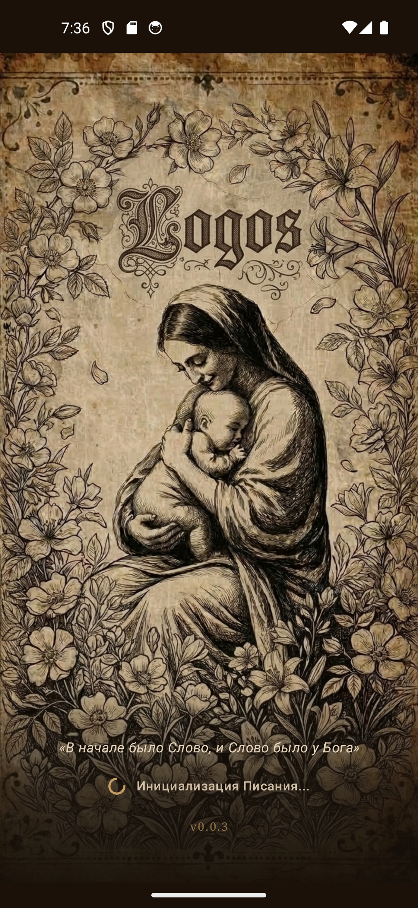
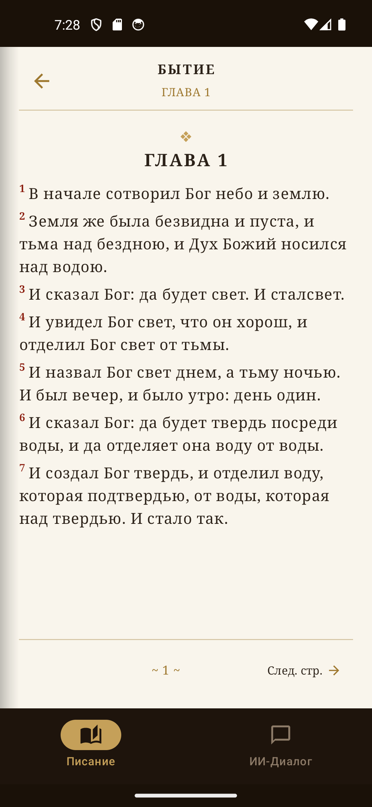
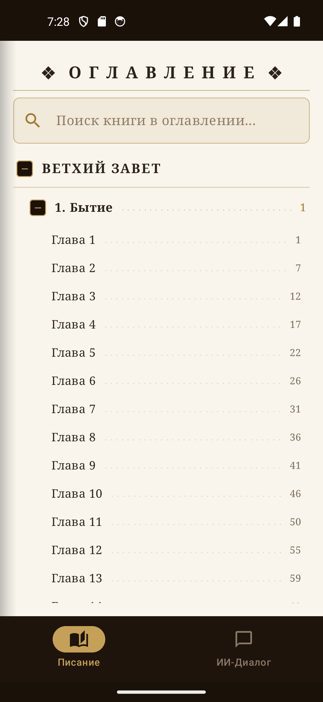
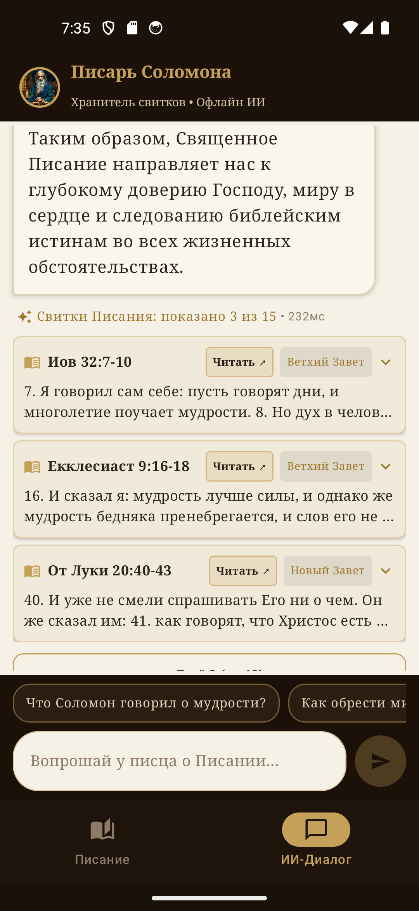
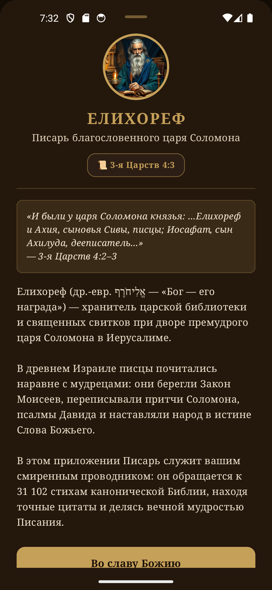

# Logos (Bible RAG) 📖✨

[](https://github.com/SolomonJSX/Logos-Bible-RAG-)
[](https://developer.android.com)
[](#-высокопроизводительное-c-ядро-on-device-rag)
[](LICENSE)

> **Полностью автономное (100% Offline) мобильное приложение для чтения Священного Писания с гибридным семантическим поиском и ИИ-собеседником «Писарь Соломона».**  
> Приложение не требует подключения к сети Интернет, сторонних серверов, аккаунтов или подписок.

---

## 📱 Скриншоты приложения

<div align="center">

| Заставка (v0.0.3) | Читалка Писания | Оглавление и главы |
| :---: | :---: | :---: |
|  |  |  |

| Писарь Соломона (ИИ-Диалог) | Биография Писаря Елихорефа |
| :---: | :---: |
|  |  |

</div>

---

## 🌟 Ключевые возможности

### 1. 📖 Аутентичный цифровой ридер Библии (Logos)
- **Эстетика антикварного фолианта**: дизайн в стиле старинного кожаного переплёта, золотого тиснения и теплого пергамента.
- **Интеллектуальная пагинация стихов**:
  - Точный расчет заполнения страницы с автоматическим переносом длинных стихов на следующую страницу по пунктуационным границам (без обрыва фраз).
  - На продолжениях перенесённых строк текст начинается естественно и сразу — без дублирования номеров стихов и лишних точек.
- **Иерархическое интерактивное оглавление**:
  - Быстрая навигация по Заветам («Ветхий Завет», «Новый Завет»).
  - Раскрывающиеся книги со сквозной пагинацией и номерами глав.
  - Полнотекстовый поиск по названиям книг в оглавлении.
- **Адаптивная поддержка ночного режима (Dark / Night Mode)**:
  - Специальная палитра `LogosTheme` для комфортного ночного чтения: глубокие оттенки темной кожи (`#140E0A`), мягкий свечной оттенок текста слоновой кости (`#E8DFC8`) и киноварные акценты номеров стихов (`#E27866`).
- **Фоновый прогрев пагинации**:
  - Предварительный расчет разметки страниц выполняется в фоне параллельно с экраном заставки, обеспечивая мгновенный отклик при перелистывании.

### 2. 🏛️ Интеллектуальный ассистент «Писарь Соломона»
- **Личность писца Елихорефа** (*3-я Царств 4:3*):
  - Придворный писец и хранитель священных свитков при дворе премудрого царя Соломона.
  - Детальная историческая справка и биография в виде удобного выдвижного свитка (`ModalBottomSheet`).
- **Синтез богословских ответов (`ScriptureSynthesizer`)**:
  - Мгновенное структурирование ответов с цитированием стихов Писания.
  - Интерактивные карточки найденных цитат с кнопкой «Читать ↗», мгновенно открывающей соответствующую книгу, главу и стих в ридере.
  - Порционная пагинация цитат (по 3 цитаты на экране с кнопкой раскрытия).
- **Предварительный фильтр темы (`TopicGuard`)**:
  - Строгая валидация входящих запросов до запуска нейросетевых вычислений: отвлечённые, математические и бытовые вопросы мгновенно и смиренно отклоняются без расхода ресурсов аккумулятора.
  - Готовые контекстные подсказки для быстрого старта богословского диалога.

### 3. ⚡ Высокопроизводительное C++ ядро (On-Device RAG)
- **Лексический поиск**: SQLite FTS5 (полнотекстовый поиск по всей базе из 31 102 стихов Синодального перевода).
- **Семантический поиск**: векторный поиск по 384-мерным эмбеддингам стихов со скалярным произведением на C++ с SIMD-векторизацией.
- **Гибридный ранжировщик**: алгоритм **Reciprocal Rank Fusion (RRF)** объединяет ключевые слова и семантическую близость.
- **Квантованные модели**: локальный запуск компактных квантованных моделей ONNX/GGUF через `llama.cpp` прямо на мобильном процессоре.

---

## 🏗️ Архитектура проекта

```text
bible-rag/
├── android/               # Мобильное приложение (Kotlin + Jetpack Compose)
│   ├── src/main/kotlin/   # UI (Reader, Chat, Bio Sheet), Theme, Repository, Orchestrator
│   ├── src/main/res/      # 3D золотая иконка mipmap, Splash тема, стили
│   └── src/main/assets/   # Предварительно индексированная БД bible.db, ONNX модель
├── cpp/                   # Высокопроизводительное нативное C++ ядро
│   ├── src/               # bible_rag_engine, simd_math, rrf_ranker, jni_bridge, sqlite3
│   ├── include/           # C++ заголовочные файлы
│   └── llama.cpp/         # Git-сабмодуль инференса LLM
├── data/                  # Данные Библии
│   └── raw/               # synodal.json (канонический текст Синодального перевода)
├── docs/                  # Документация и медиа-материалы
│   └── screenshots/       # 5 ключевых скриншотов приложения
├── Logos-Bible-v0.0.3.apk # Готовая оптимизированная сборка APK для Android
└── src/                   # Python-пайплайн подготовки данных
    ├── parser.py          # Парсинг стихов и структурирование
    ├── export_onnx.py     # Квантование модели эмбеддингов в ONNX (int8)
    └── build_mobile_db.py # Создание SQLite FTS5 + векторных таблиц
```

---

## 📦 Готовый APK

Готовый установочный файл версии **v0.0.3** доступен непосредственно в корне репозитория:
- [`Logos-Bible-v0.0.3.apk`](Logos-Bible-v0.0.3.apk) (~71.7 МБ)

Установка на устройство через ADB:
```bash
adb install -r Logos-Bible-v0.0.3.apk
```

---

## 🚀 Сборка из исходников

### 1. Клонирование репозитория
```bash
git clone --recursive https://github.com/SolomonJSX/Logos-Bible-RAG-.git
cd bible-rag
```

### 2. Сборка Android приложения
Для сборки требуется Android SDK и JDK 17+:
```bash
cd android
./gradlew assembleRelease
```
Собранный APK будет находиться в `android/build/outputs/apk/release/android-release.apk`.

### 3. Запуск Python пайплайна (опционально)
Для пересборки базы `bible.db` из сырого JSON:
```bash
uv sync
uv run python src/build_mobile_db.py
```

---

## 📜 Лицензия
Распространяется под свободной лицензией [MIT](LICENSE).
Канонический текст Синодального перевода Библии является общественным достоянием (Public Domain).
